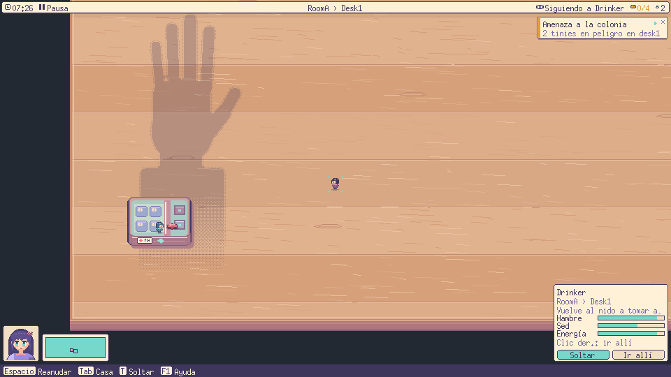

# Spec: actividades de los tinies en la casa (M61–M71)

Esta especificación documenta las mecánicas, componentes, contenido, arte y cierre de cada hito del slice descrito en la [propuesta](../propuesta.md#21-actividades-de-los-tinies-en-la-casa).

## M61 — Agua del baño y la cocina

### Simulación
- **Vencimiento genérico (`internal/sim/expire`)**:
  - Store `"expires"` (`expire.Expires{At, TTL, Kind}`): si `At == 0 && TTL > 0`, resuelve `At = w.Tick() + TTL` en el primer tick en que corre el sistema.
  - Sistema `expire` en `clock.PhaseFlush` (orden `1 << 20`, instalado en `engine.New`): despawnea en orden ascendente de `ids.ID` toda entidad viva con `w.Tick() >= At` y emite `expire.Expired{Entity, ItemKind}` (`"kind"` en JSON).
  - Invariante `"expire"` registrada con `world.AddInvariant`.
- **Depósito por tipo (`internal/sim/ai`, `internal/sim/colony`)**:
  - `ai.Portions` guarda `Items []ai.ResourceAmount` ordenados por nombre de recurso (`food`, `water`), serializados como lista ordenada (D5). Acepta en JSON tanto `{"items":[...]}` como el formato histórico `{"left": N}` (mapeado a `food`).
  - `ai.Step.Resource` y `ai.Consumed.Resource` seleccionan el recurso consumido (`""` equivale a `"food"`).
  - `ai.Offer.Requires` permite exigir la presencia de entidades por nombre en el Space o sus hijos directos (usado por `wash_dishes` para requerir vajilla `cup`/`plate`).
  - `colony.Colony.Stock` pasa a `colony.Stock` (lista ordenada de `StockGoal{Resource, Amount}`, D5; acepta entero, objeto o lista en JSON). `colony.Deficit(w, col, resource)` calcula el déficit por recurso.
  - Componentes `"water"` (`colony.Water`) y `"water_drop"` (`colony.WaterDrop{Volume}`). `colony.share` publica acarreos (`haul`) tanto para `food` como para `water`; `colony.store` almacena por recurso, sincroniza `WaterDrop.Volume` con `ai.Portions("water")` y emite `colony.Stored{..., Resource}`.
- **Sed (`thirst`)**:
  - Necesidad `thirst` en los tinies, con decaimiento más lento que `hunger`.
  - `scenario.Randomize` la sortea al final (`randomActivities`), sin alterar el stream previo.
- **Versiones**: `world.HashVersion = 14`, `world.SnapshotSchema = 17`.

### Contenido y rutinas
- `content/objects/water_drop.json`: gota con `water_drop{volume: 3}`, `water`, `portions` (`water: 3`), `expires{ttl: 2400, kind: "water_drop"}` y oferta `drink` (escala `tiny`, efecto en `thirst`).
- `content/objects/puddle.json`: charco con volumen 6 y vencimiento 4800 ticks.
- `content/objects/nest.json`: suma la oferta `drink` (consume `water`, `keep: true`).
- `content/objects/washbasin.json`: oferta `wash_hands` (escala `giantess`, efecto en `hygiene`, `spawn` de 3 `water_drop` con dispersión).
- `content/objects/sink.json`: oferta `wash_dishes` (escala `giantess`, efecto en `hygiene`, `requires: ["cup", "plate"]`, `spawn` de 3 `water_drop` con dispersión).
- Escenarios generados por `tools/scenarios/actividades.py`: `tiny_drinks_drop.json`, `drop_evaporates.json`, `water_hauled_to_nest.json` y `giantess_washes_hands.json`.

### Presentación y sonido
- **Arte (`tools/art/actividades.py`, `ui.py`, `giantess.py`)**:
  - `water_drop` micro (6 × 6 px, `idle` de 2 cuadros y `low`; macro `hidden`).
  - `puddle` micro (14 × 6 px, `idle` de 2 cuadros y `low`; macro `hidden`).
  - `nest_water` micro (18 × 10 px, `empty`, `half`, `full`), compuesta sobre el nido en vista micro según el agua del depósito.
  - `ui/emote_thirst.png` (`view.EmoteThirst`) y clips `wash_{east,west,north,south}` de 4 cuadros en `giantess`.
- **Lectura (`cmd/game/hud.go`, `internal/view/story.go`)**: «Toma agua en ...», «Lleva agua al nido», «Se lava las manos», «Lava los platos» y entradas de crónica para gotas dejadas y agua guardada.
- **Sonido (`tools/audio/sounds.json`, `internal/sound/scene.go`)**: `water_drip` al aparecer gotas, `faucet_run` durante `wash_hands`/`wash_dishes` y `emote_thirst`.

### Cierre y captura
- Escenarios de cierre verificados en `TestScenarios` y `internal/scenario/m61_test.go` (`TestM61TinyDrinksDrop`, `TestM61DropEvaporates`, `TestM61WaterHauledToNest` con continuidad desde snapshot, `TestM61GiantessWashesHands`, `TestM61DeficitByResource`).

## M63 — Tesoros perdidos y regalos

### Simulación
- **Tesoros (`colony.Trinket`)**: componente `"trinket"` (`Kind`: `button`, `clip`, `thread`, `graphite`; `Uses`; `Giver`), siempre con `ai.Landmark` para aprenderse sin ofertas. `colony.hoard` publica acarreos (`haul`) hacia el nido cuando no hay déficit de comida ni de agua.
- **Botín (`colony.SearchSpot.Loot`)**: lista ponderada de tesoros sorteada con `w.RNG("colony.loot")` al revisar un `search_spot`. Emite `colony.TrinketFound`.
- **Colección (`colony.Hoard`)**: componente `"hoard"` en el nido (lista ordenada de IDs, D5). `colony.hoard` almacena tesoros sueltos cerca del nido y emite `colony.TrinketStored`. `colony.hoard_fun` (`PhaseSlow`) eleva el piso de `fun` en `150` por cada tipo distinto (tope `600`) y frena su decaimiento.
- **Regalos (`colony.GiftSpot`, `colony.Gift`, `encounter.NoticeGift`)**:
  - Un tiny con `fun >= 700` y un tesoro repetido en el `hoard` lo lleva a un `gift_spot` libre (`colony.GiftPlaced`).
  - La giantess nota el regalo (`encounter.NoticeGift`), se detiene, mira, baja su enfriamiento de `share` en esa superficie y emite `encounter.GiftNoticed`.
- **Versiones**: `world.HashVersion = 15`, `world.SnapshotSchema = 18`.

### Contenido, sprites, lectura y sonido
- Objetos: `trinket_button.json`, `trinket_clip.json`, `trinket_thread.json`, `trinket_graphite.json` y `hoard` en `nest.json`. En `casa.json`: puntos de botín bajo el futón, frente al placard bajo, junto al zapatero y debajo de la alfombra, y `gift_spot` en escritorio y mesa del living.
- Sprites (`tools/art/actividades.py`, `ui.py`): los cuatro tesoros en micro (`idle` + `held`) y punto macro de 2 × 2 px (`selected_only`), capa `nest_hoard` en tres etapas (`one`, `few`, `pile`), y emotes `treasure` y `curious`.
- Crónica y sonido: entradas en `view.storyText` («La colonia encontró su primer botón.», «Ella encontró el regalo de ...»), `trinket_clink`, `trinket_found`, `emote_treasure` y `emote_curious`.

### Cierre
- Escenarios en `tests/scenarios/` y tests en `internal/scenario/m63_test.go`: `tiny_finds_trinket` (sorteo reproducible), `hoard_raises_fun` y `giantess_notices_gift` (con continuidad desde snapshot).
