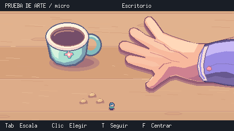

# Base de presentación

`go run ./cmd/game -art` abre la prueba de arte del escritorio. Usa el mismo runner, simulación y cámara del visor. El escenario asigna un `visual` por entidad. El código de presentación vincula ese identificador al ID generacional que resolvió el escenario. El vínculo queda fuera del estado de simulación, el hash y los snapshots.

La presentación dibuja en un lienzo de 480 × 270 píxeles. Usa el mayor múltiplo entero disponible en la pantalla final y centra el lienzo con bandas. El cursor usa la transformación inversa de ese mismo rectángulo. Las bandas quedan fuera de la escena.

Cada variante se dibuja a escala nativa con el pivote en la posición de mundo interpolada, redondeada a un píxel del lienzo. El hit test recorre los sprites visibles en orden inverso al dibujo y consulta el alfa del mismo cuadro dibujado. El modo de prueba usa densidades de 16 px por 40 cm en macro y 16 px por 10 mm en micro.

El manifiesto JSON declara el PNG y dos variantes por sprite, `macro` y `micro`. Cada variante declara un pivote `[x, y]` relativo al cuadro y clips con duración en ticks y cuadros `[x, y, ancho, alto]` en el atlas. El clip `idle` es obligatorio. La carga identifica el manifiesto y el sprite, variante, clip o cuadro ante una exportación inválida.

## Prueba de arte

`Tab` alterna entre la vista del estudio y la superficie seleccionada. El foco inicial de micro es el escritorio. El clic elige un sprite, `T` sigue la selección y `F` vuelve a centrar. Las dos vistas usan la misma taza y el mismo tiny. El escritorio y la palma representan madera y piel con la densidad de cada vista.

| Macro | Micro |
| --- | --- |
|  |  |

Las referencias muestran la [dirección anime](../propuesta.md#11-dirección-visual) en el tick inicial del [escenario de prueba](../../tests/scenarios/muestra_pixel_art.json), a 1×. El cárdigan lila vincula el sprite macro de la giantess con la manga de la vista micro. Se puede cargar otra exportación con `-atlas ruta/al/manifiesto.json` o usar `-size` para revisar otros tamaños de ventana.

```sh
go run ./cmd/game -art -size 480x270 -shot macro.png
go run ./cmd/game -art -micro Escritorio -size 480x270 -shot micro.png
```
