# Base de presentación

`go run ./cmd/game -art` abre la prueba de arte del escritorio. Usa el mismo runner, simulación y cámara del visor. El escenario asigna un `visual` por entidad. El código de presentación vincula ese identificador al ID generacional que resolvió el escenario. El vínculo queda fuera del estado de simulación, el hash y los snapshots.

La presentación dibuja en un lienzo de 480 × 270 píxeles. Usa el mayor múltiplo entero disponible en la pantalla final y centra el lienzo con bandas. El cursor usa la transformación inversa de ese mismo rectángulo. Las bandas quedan fuera de la escena.

Cada variante se dibuja a escala nativa con el pivote en la posición de mundo interpolada, redondeada a un píxel del lienzo. El hit test recorre los sprites visibles en orden inverso al dibujo y consulta el alfa del mismo cuadro dibujado. El modo de prueba usa densidades de 16 px por 40 cm en macro y 16 px por 10 mm en micro.

El manifiesto JSON declara el PNG y las variantes por escala de cada sprite. Cada variante declara un pivote `[x, y]` relativo al cuadro y clips con duración en ticks y cuadros `[x, y, ancho, alto]` en el atlas. El clip `idle` es obligatorio. La carga identifica el manifiesto y el sprite, variante, clip o cuadro ante una exportación inválida.

## Fuentes del arte

`content/art/casa.png` y `content/art/casa.json` se generan a partir de `content/art/src/casa/` y no se editan a mano. La carpeta de fuentes tiene un PNG por cuadro, agrupado por sprite, y un `atlas.json` con la misma forma que el manifiesto exportado. La diferencia es que cada cuadro y cada `foreground` nombra un archivo en lugar de un rectángulo. Un cuadro también puede ser una lista de capas del mismo tamaño, que se componen de abajo hacia arriba.

`artpack` ubica los cuadros en estantes, ordenados por alto, ancho y nombre, con un píxel de separación. Los cuadros con los mismos píxeles comparten lugar. Las mismas fuentes producen los mismos bytes, y `TestCasaAtlasMatchesSources` falla si el atlas versionado se desfasa de ellas.

```sh
go run ./cmd/artpack                # rearma content/art/casa.{png,json}
go run ./cmd/artpack -check         # solo verifica
```

La muestra de M12 (`content/art/muestra.*`) queda congelada como referencia y no tiene fuentes.

Parte de las fuentes se dibuja por código con los scripts de `tools/art/` (Python con Pillow): `rooms.py` para habitaciones, futón, puertas y heladera; `micro.py` para la etiqueta del nido y el posavasos; `hand.py` para la mano; y `sprites.py` para el tiny, las poses de la giantess, la palma en sus cuatro orientaciones y la taza en mano. `px.py` reúne las primitivas de dibujo. Los scripts parten de las piezas originales de M14 guardadas en `tools/art/base/`. Una pieza generada se ajusta en su script, no en el PNG, porque la próxima ejecución la sobrescribe. Para retocar una pieza a mano en un editor, hay que quitarla antes de su script. `-check` regenera en una carpeta temporal y compara píxeles con las fuentes versionadas.

```sh
python tools/art/build.py -check    # las fuentes coinciden con los scripts
python tools/art/build.py           # regenera las piezas dibujadas por código
go run ./cmd/artpack                # rearma el atlas
```

## La casa en macro

El escenario de «Una mañana en la casa» enlaza su atlas por la ruta `atlas`, relativa al archivo del escenario. El manifiesto puede declarar las escalas disponibles. Un atlas sin esa lista ofrece las dos escalas. `-atlas` permite reemplazar el manifiesto elegido por el escenario.

El dibujo macro coloca primero las variantes `layer: "background"`, después los umbrales y detalles del suelo de `layer: "ground"`, luego las piezas por su línea de apoyo en pantalla y por último su `foreground` opcional. El primer plano usa el mismo pivote que el cuadro base. `depth_offset` desplaza la línea de apoyo vertical en píxeles. Los ocupantes de un mueble comparten su orden de profundidad y se dibujan encima del mueble. El picking usa el orden final y el alfa de cada capa.

Los sprites que ofrecen clips `idle_north` o `walk_north` y sus variantes para las otras tres direcciones los eligen a partir de la orientación o el tramo activo de la ruta. Las variantes sin esos clips usan `idle` y, si está disponible, `walk`. Las puertas se dibujan en el punto medio de los portales estáticos asociados a un visual.

La casa se abre con este comando. Hacé clic en la giantess para elegirla y pulsá `T` para seguirla. `F` recupera el encuadre completo. `Espacio` pausa y `1/2/3` elige la velocidad.

```sh
go run ./cmd/game -art -scenario tests/scenarios/una_manana_en_la_casa.json
```

La casa sigue la [ambientación japonesa](../propuesta.md#ambientación): dormitorio de tatami con futón, cocina con arrocera y pava, living de madera con zabuton y alfombra de seigaiha. El paso entre cocina y dormitorio usa el visual `door_noren` y el del living, `door` (fusuma). En micro, el labio del nido lleva la etiqueta de la caja de fósforos y la mesa del living, un posavasos de bambú.

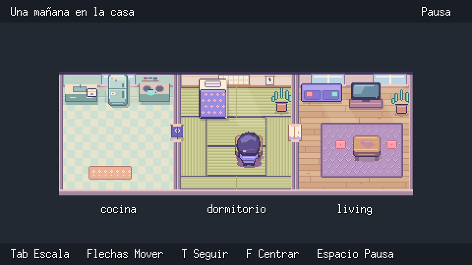

La prueba del visor verifica el picking sobre la giantess y los umbrales, el seguimiento del dormitorio a la cocina y de regreso al dormitorio antes de llegar al living, y la igualdad del hash con la ejecución headless.

## Lote de animación

El atlas de la casa ya tiene los clips que van a usar los hitos de animación, contacto y partida. `TestMorningAtlasCoversPresentation` recorre los `visual` del escenario y de `content/objects` y verifica que cada uno exista en el atlas con estos clips:

| Visual | Escala | Clips |
| --- | --- | --- |
| `giantess` | macro | `idle`, `walk`, `reach` (mano estirada), `sit` (seiza sobre zabuton) y `eat` (sentada, con onigiri) en las cuatro direcciones |
| `tiny`, `tiny_lavender`, `tiny_ochre` | micro | `idle`, `walk` y `carry` (brazos arriba) en las cuatro direcciones, y `fall` |
| `palm` | micro | `rested` (sombra pegada) y `raised` (sombra separada). `idle` es la palma apoyada |
| `cup` | macro y micro | `held`, sin sombra de contacto |

Los nombres con dirección usan el sufijo `_north`, `_east`, `_south` o `_west`. Un clip pedido que no existe cae al nombre sin sufijo y después a `idle`. Los ojos del tiny tienen dos píxeles, con el inferior más claro como brillo, y su sombra es translúcida para leerse igual sobre madera y piel.

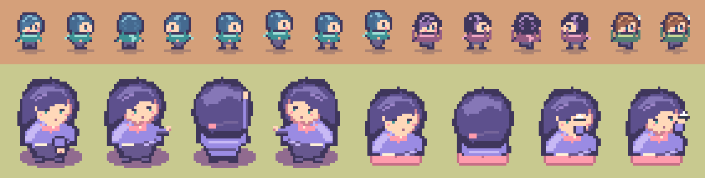

## Animación por estado

El clip de cada entidad sale del estado que trae el `Frame`. `view` publica la acción del agente (`activity`, como `use:breakfast`) y, si la oferta tiene pasos, el paso en curso (`step`: `goto`, `pose`, `use`). La giantess es un Space y también los publica. El renderer arma una lista de clips candidatos y usa el primero que exista en la variante:

1. Con el mover en marcha: `carry_<dir>` si lleva algo, `walk_<dir>`, `walk`. La dirección sale del tramo activo de la ruta.
2. Quieto, con una oferta en su paso `use` (o sin pasos): la pose de la acción según `poseClips` (`breakfast`, `snack`, `eat` y `nibble` → `eat`; `watch` → `sit`). La dirección sale de la orientación.
3. Con una parte propia apoyada en otra superficie, es decir, un Space hijo en un contacto: `reach_<dir>`.
4. `idle_<dir>` y, al final, `idle`.

Una superficie móvil sin mover, como la palma, usa `rested_<dir>` si está en un contacto y `raised_<dir>` si no. La dirección es la de su orientación de mundo. La palma se dibuja en un cuadro cuadrado con el pivote en el centro para que las cuatro orientaciones compartan el pivote. La sombra no gira con la mano porque la luz siempre viene de arriba a la izquierda. Lo que se carga usa `held` (la taza en mano no tiene sombra de contacto). El desplazamiento `carry` se espeja en X cuando el porteador mira al oeste. Los tinies llevan la carga sobre la cabeza, entre las manos levantadas.

Las poses sentadas bajan el torso siete píxeles para que el escritorio o la mesa que la giantess tiene delante sigan a la vista. `ArtScene.Clip(id)` devuelve el clip elegido. `TestMorningAnimationFollowsState` recorre la mañana y verifica en cada tick la giantess (caminar, comer, sentarse frente a la TV, mano apoyada), la taza (en mano o apoyada), la palma (apoyada o elevada, con su orientación) y los tinies del escritorio (caminata o acarreo).

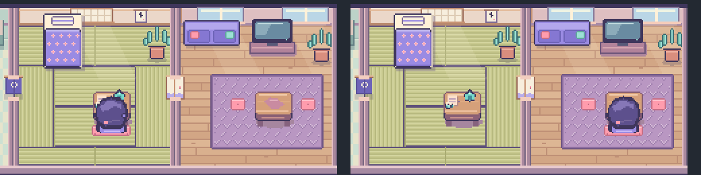

La mano es la derecha, con la palma hacia arriba, los dedos juntos y el pulgar abierto. Cada parte es una forma con distancia con signo, y de esa distancia salen el contorno malva, las costuras entre dedos, los pliegues de las falanges y el sombreado de celda con luz desde arriba a la izquierda. El antebrazo con el puño acanalado sigue más allá de la palma, así que con la palma centrada el corte de la manga queda fuera de pantalla. Los cuadros miden 480 × 480 px con el pivote en el centro.

La grilla de la palma en el escenario sale de `hand.grid_rows()`: una celda de 1 cm por cada 16 px del dibujo, transitable si la mano o la manga cubren al menos la mitad. Así, los tinies que viajan quedan sobre la mano en las cuatro orientaciones. Si cambia el dibujo de la mano, hay que regenerar también esa grilla.

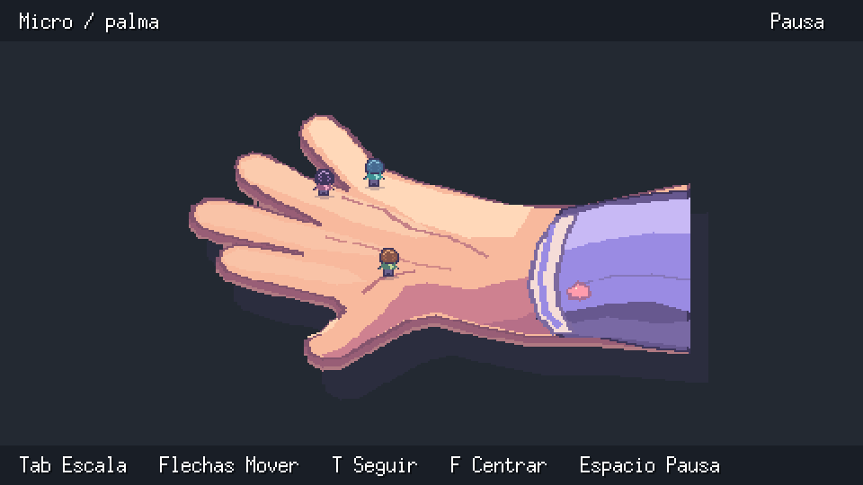

## Contacto, viaje y caídas

**Señal del paso.** En micro, cada portal de contacto muestra el visual `pass` en sus dos extremos cuando la superficie de ese extremo está en el foco. El clip `open` muestra dos anillos turquesa unidos que laten, y `closed` los muestra lilas y separados si el portal está deshabilitado. `view.Portal` trae el Space de cada extremo (`a_space`, `b_space`). Durante el viaje no hay contacto, así que no hay señal. La palma apoyada se distingue de la levantada por la silueta (`rested`/`raised`), por la sombra pegada o separada y por la señal.

**Sombra anticipada.** Una superficie móvil que no está en el foco proyecta `shadow_<dir>` sobre la superficie enfocada cuando está encima, a menos de 1 m y con el centro sobre ella o a menos de media extensión del borde. Cuanto más baja, más oscura y más pegada al apoyo. La sombra es una silueta tramada que se desvanece hacia el antebrazo. En la mañana, la giantess sostiene la mano suspendida 12 ticks antes de apoyarla, en el desayuno y frente a la TV, así que la sombra se ve antes de la llegada.

**Seguimiento.** Seguir a un tiny (`T`, o `-follow <nombre>` al arrancar) mantiene la vista micro en la superficie donde está. Cuando el tiny pasa del escritorio a la palma o de la palma a la mesa, el foco y el rótulo cambian con él. Si una superficie más alta lo tapa (al bajar, el extremo del paso queda bajo la mano), lo seguido se dibuja además translúcido por encima de todo.

**Caídas.** La simulación resuelve una caída en un tick y publica `entity_fell`. El `Runner` guarda las caídas recientes en `Frame.Falls`, y durante `view.FallTicks` (10 ticks) el tiny usa el clip `fall`. Arranca a la altura de la caída en pantalla, hasta 48 px, y baja con aceleración hasta su apoyo, donde su sombra (`shadow`) se oscurece a medida que llega. Las caídas no tienen sombra horneada. El escenario `tiny_cae_de_la_palma.json` sale de `tools/scenarios/tiny_cae_de_la_palma.py`: un tiny queda fuera del borde de la palma levantada y cae 65 cm sobre el escritorio.

`ArtScene.Marks(id)` lista las sombras y señales colocadas para una entidad, y `ArtScene.Lift(id)` lista cuánto se levantó su sprite. Las pruebas recorren la mañana:

- `TestMorningPassSignalMatchesPortals` verifica que las señales coincidan con los portales en cada tick.
- `TestHandShadowAnticipatesContact` verifica que haya sombra antes de cada apoyo y ninguna con la mano apoyada.
- `TestFollowTinyThroughTrip` verifica que Tiny 01 vaya del escritorio a la palma y a la mesa del living con el foco y la cámara sobre él.

`TestFallIsAnimatedAndFollowed` cubre la caída en su escenario.

```sh
go run ./cmd/game -art -scenario tests/scenarios/una_manana_en_la_casa.json -follow "Tiny 01"
go run ./cmd/game -art -scenario tests/scenarios/tiny_cae_de_la_palma.json -follow "Tiny 01"
```

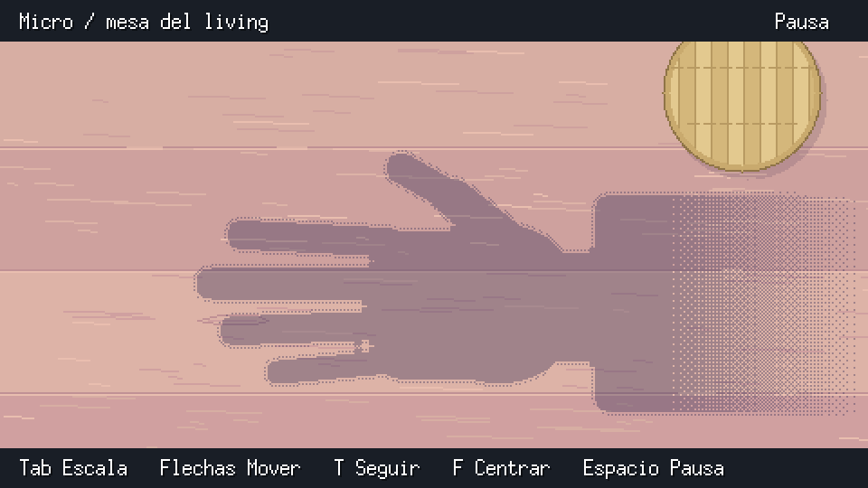

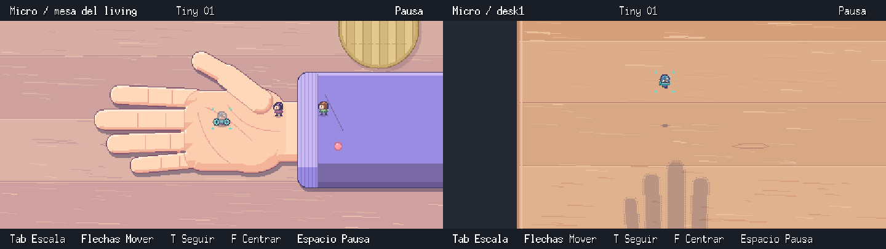

## Interfaz de partida

Con un escenario que declara `atlas` (la casa), `-art` abre la interfaz de partida. El juego arma un `ui.HUD` a partir del `Frame` (`g.partida`), y `HUD.Draw` lo dibuja sobre el lienzo de 480 × 270 con paneles marfil de esquinas redondeadas, borde ciruela y la fuente pixel de 12 px de `bitmapfont`, que trae tildes y eñes.

- **Barra superior.** Muestra el reloj de la casa: la mañana empieza a las 7:00 y cada segundo simulado es un minuto. La velocidad se lee por forma (dos barras en pausa, uno a tres triángulos) y por texto. El centro lleva el rótulo jerárquico de ubicación: en micro, el Space que contiene a la superficie y la superficie («Dormitorio › Escritorio», «Giantess › Palma»); en macro, la casa y la habitación de lo seguido o elegido. A la derecha aparece «Siguiendo a …» cuando hay seguimiento.
- **Barra inferior.** Muestra los controles como teclas con su rótulo: `Espacio` pausa, `1-3` velocidad, `Tab` escala, `T` seguir, `F` encuadre general, `H` historia y `F3` debug.
- **Historia.** Presenta el retrato de la giantess junto a un globo con las entradas recientes. Cada `view.StoryEntry` trae su actor y su lugar, y la flecha turquesa marca las que se pueden enfocar. Un clic sigue al actor en la vista micro de su superficie (a la giantess, en macro) o, si el actor ya no está, abre la vista micro del lugar.
- **Inspector resumido.** Al elegir una entidad muestra su nombre con su símbolo, su ubicación, la actividad en castellano («Va a desayunar», «Acarrea una migaja», «Descansa en la taza»), las necesidades y la orden disponible («Clic der.: ir allí», que manda `move_to`). Cada necesidad tiene barra y rótulo, y una necesidad baja lleva además «!» y la barra rayada, para leerse sin color.
- **Símbolos de expresión.** `Frame.Emote(id)` los calcula. Los que salen de eventos duran `view.CueTicks` (2 s) y el `Runner` los guarda en `Frame.Cues`: «!» cuando un tiny nota comida, la gota al subir a la mano y la vena si le interrumpen una oferta en uso. Los que salen del estado son la gota al caer o viajar en la mano levantada, «?» al explorar, «zzz» al descansar o dormir y la nota al mirar la TV. En micro se dibujan sobre cada tiny; en macro, sobre la giantess y lo elegido o seguido.
- **Retrato.** `Frame.Expression(id)` elige la expresión según este orden:
  1. sorprendida si algo acaba de subir a su mano;
  2. contenta mientras come o mira la TV;
  3. somnolienta o hambrienta si esa necesidad está por debajo de 300;
  4. neutral en cualquier otro caso.

  El `Frame` publica las necesidades de cada agente (`needs`).
- **Debug.** `F3` (o `-debug` al arrancar) superpone al arte las rutas, los portales y los contactos (`render.DrawOverlays`, con las capas `G P C R L`) y una línea con tick, hash y FPS. El visor de debug completo sigue siendo `go run ./cmd/game` sin `-art`.

El retrato y los símbolos salen de `tools/art/ui.py`. El retrato es un busto de 48 × 48 px con cinco expresiones que comparten cabeza, pelo y ropa. Los símbolos son plantillas de 11 × 11 px con formas distintas.

Las pruebas son las siguientes:

- `TestPartidaShowsMorningCues` recorre la mañana. Verifica que el descubrimiento de las migajas, el ascenso a la palma, la exploración, el descanso en la taza y la TV se vean con su símbolo, y que el retrato pase por hambrienta, contenta, sorprendida y neutral.
- `TestPartidaLocationAndCard` cubre el rótulo y el inspector.
- `TestPartidaStoryFocus` cubre el enfoque desde la historia.
- `TestPartidaSessionKeepsHash` cubre una sesión completa: cambia de escala, da un paso en pausa, sigue a un tiny, vuelve al encuadre general y activa el debug, y termina con el mismo hash que la ejecución headless.

```sh
go run ./cmd/game -art                      # la mañana en la interfaz de partida
go run ./cmd/game -art -follow "Tiny 01"    # siguiendo a un tiny desde el arranque
go run ./cmd/game -art -debug               # con rutas, portales y contactos
```

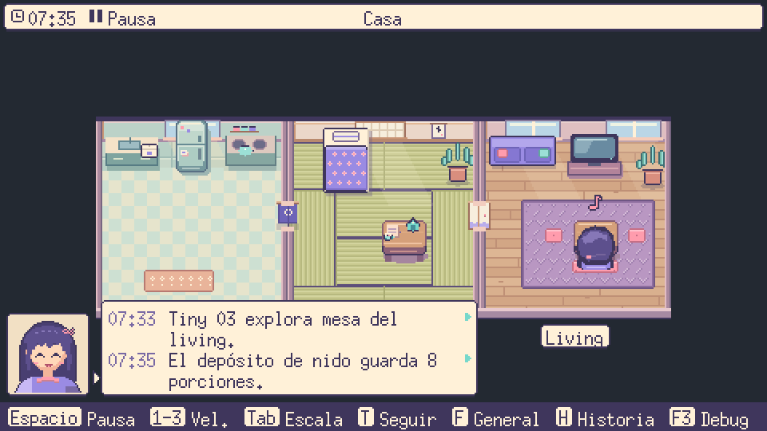

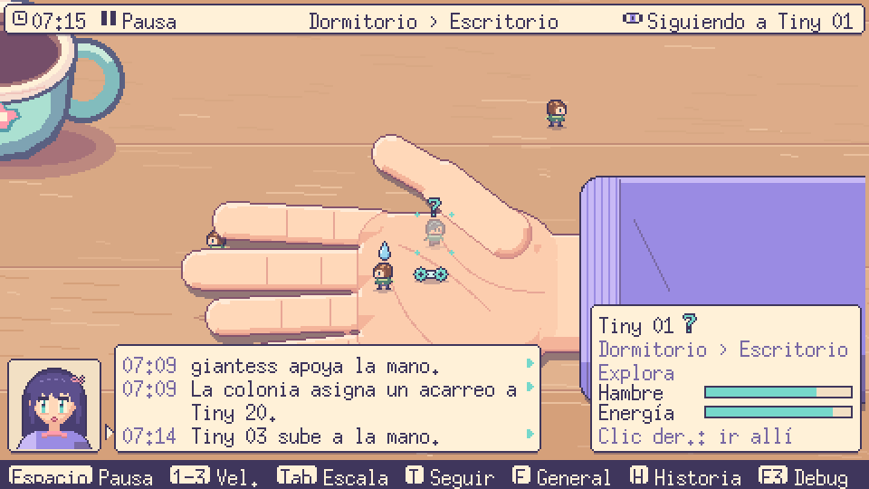

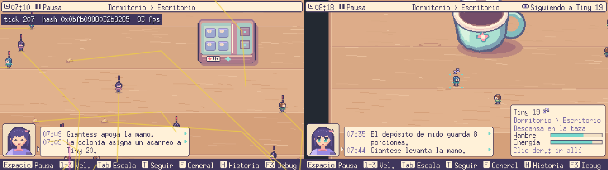

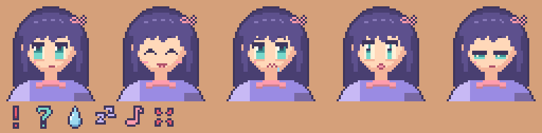

## Superficies y colonia en micro

`Tab` enfoca la superficie de la entidad seguida o seleccionada. Con la selección vacía enfoca el escritorio. Una segunda pulsación recupera el encuadre macro previo o mantiene la cámara sobre la entidad seguida. La selección conserva el mismo ID generacional. El cambio aplica un fundido de 180 ms incluso en pausa. `-reduced-motion` usa un corte directo.

El escritorio, la mesa del living y la palma tienen variantes micro. El nido se reconoce por la caja de fósforos y la manta. El contorno de los muebles y el labio del nido usan `foreground`. Micro dibuja cada superficie por altura, con sus ocupantes entre la base y el borde frontal. Las superficies en contacto aparecen juntas cuando se enfoca una de ellas.

El atlas puede declarar una variante `hidden: true` o limitar un marcador a las entidades seleccionadas o seguidas con `selected_only`. `focus` indica el centro de interés de una superficie dentro de su imagen. `carry` desplaza la carga respecto del pivote del porteador en píxeles. La presentación toma el porteador del `Frame` e interpola su posición antes de aplicar ese desplazamiento.

El escenario registra el identificador `visual` de `entity_spawned` y lo asocia al ID publicado. La taza y las migajas lo declaran en sus definiciones de contenido, así que conservan su apariencia al pasar de la mano a una superficie o durante un acarreo. Al destruirse se elimina la asociación. La prueba verifica que la taza del desayuno se selecciona en ambas vistas con el mismo ID y que cambiar de escala conserva el seguimiento y el hash.

```sh
go run ./cmd/game -art -scenario tests/scenarios/una_manana_en_la_casa.json -micro escritorio
```

| Escritorio | Mesa del living |
| --- | --- |
| 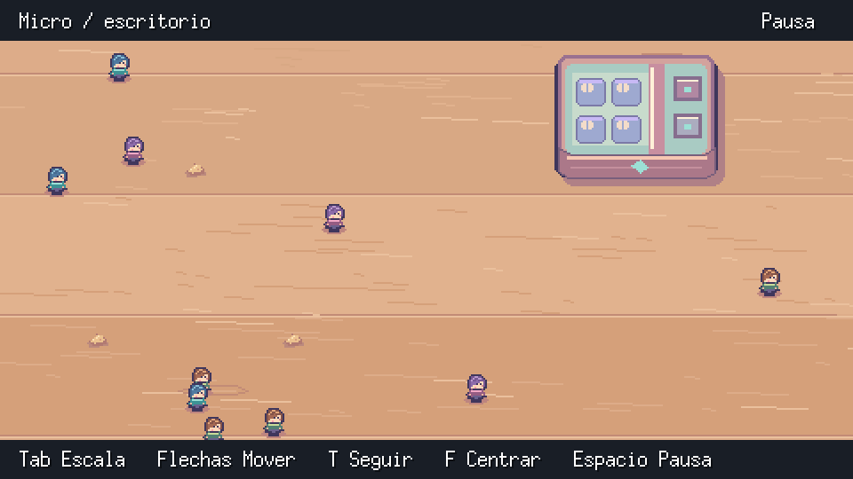 | 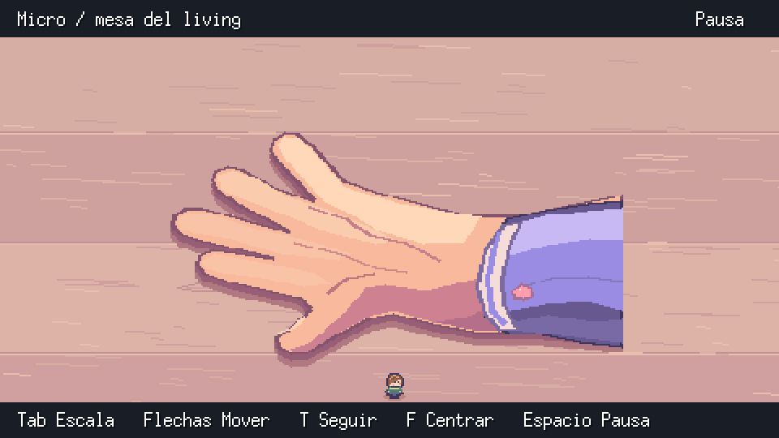 |

## Prueba de arte

`Tab` alterna entre la vista del estudio y la superficie seleccionada. El foco inicial de micro es el escritorio. El clic elige un sprite, `T` sigue la selección y `F` vuelve a centrar. Las dos vistas usan la misma taza y el mismo tiny. El escritorio y la palma representan madera y piel con la densidad de cada vista.

| Macro | Micro |
| --- | --- |
| 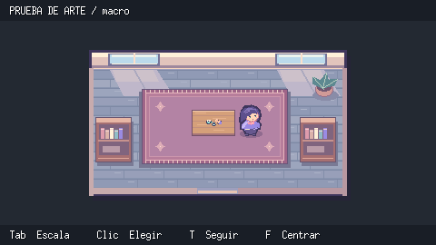 |  |

Las referencias muestran la [dirección anime](../propuesta.md#11-dirección-visual) en el tick inicial del [escenario de prueba](../../tests/scenarios/muestra_pixel_art.json), a 1×. El cárdigan lila vincula el sprite macro de la giantess con la manga de la vista micro. Se puede cargar otra exportación con `-atlas ruta/al/manifiesto.json` o usar `-size` para revisar otros tamaños de ventana.

```sh
go run ./cmd/game -art -size 480x270 -shot macro.png
go run ./cmd/game -art -micro Escritorio -size 480x270 -shot micro.png
```
